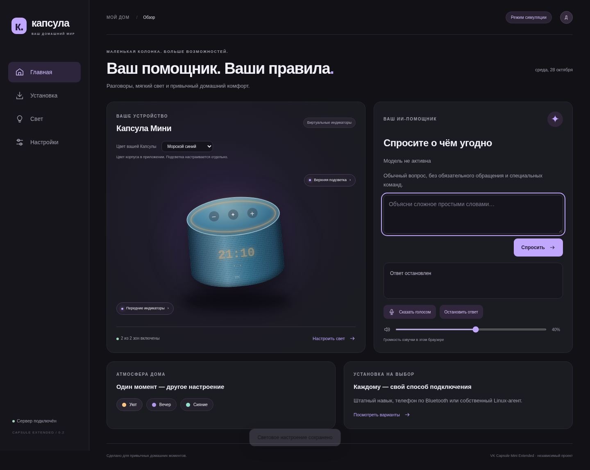

# Капсула · Дом

ИИ-помощник, интерактивная Капсула Мини и отдельные настройки переднего и верхнего света. **Приложение для Linux и симулятор периферии; не универсальная прошивка.**



Можно задавать обычные вопросы без обязательного обращения. Цвет корпуса выбирается из пяти вариантов по референсу: светлый серый, хвойный зелёный, морской синий, терракотовый, тёмный серый. Он сохраняется отдельно от цвета индикаторов.

## Выберите свой способ установки

На вкладке **«Установка»** собраны четыре варианта с требованиями и ссылками:

1. Навык Маруси — штатный голосовой интерфейс и свой ИИ-backend без замены ОС.
2. Телефон по Bluetooth — звук приложения через Капсулу, микрофон телефона.
3. Временный SSH-агент — для устройства с уже доступным root и совместимым звуком.
4. Linux-клиент — наш сервер и запись одной фразы либо совместимый аппаратный агент.

[Сравнение и подробности](docs/simple-assistant-setup.md). Готового опубликованного навыка и универсального получения root в этом проекте нет. Пользователь выбирает подходящий вариант сам.

## Запустите наше приложение

Нужны Linux и Python 3.12+:

```bash
git clone https://github.com/PANDORA615/VK-Capsule-Mini-Extended.git
cd VK-Capsule-Mini-Extended
python3 -m venv .venv
. .venv/bin/activate
pip install -e .
cp .env.example .env
capsulectl serve
```

Откройте **http://127.0.0.1:8080**. Без ключа можно проверить меню, цвет корпуса, световые сценарии и сохранение настроек. Ответы ИИ не подменяются демо-текстом: для них нужен свой ключ.

- Gemini Live и резервный Flash-Lite → Piper, отдельные cooldown и диагностика 429/401/403.
- Текстовые вопросы, запись одной фразы через Vosk, озвучка в браузере, остановка ответа.
- Программный mute, необязательное обращение, безопасная громкость браузерного ответа.
- Интерактивные верхняя/передняя зоны, яркость, цвет и эффекты, пять цветов корпуса.
- Подключение дисплея через `v3rt3p/marusya-server`, ночника через `yawaflua/Gemini-for-Capsula`.
- Утилиты чтения образов, идентификации и проверки экспортированных резервных копий. Записи flash нет.

## Документация и проверки

[Полный гайд](docs/installation.md) · [Интеграции](docs/integrations.md) · [Отчёт](docs/qa/report.md) · [Железо](docs/research/hardware-matrix.md)

```bash
pip install -e '.[dev,ai]'
pytest -q
ruff check capsule tests scripts
mypy capsule
# С запущенным сервером:
CHROMIUM_PATH=/usr/bin/chromium python scripts/check_ui.py
```

Физические микрофоны, дисплей, LED, Wi-Fi и загрузка на конкретной плате требуют аппаратной проверки. Смена имени в меню не обучает акустический wake word. Неофициальный проект, не связан с VK или Google. [MIT](LICENSE).
